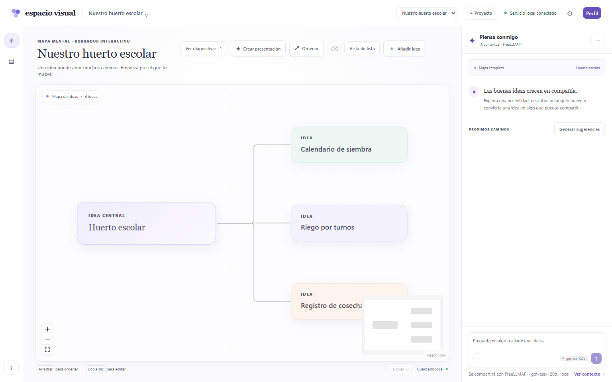
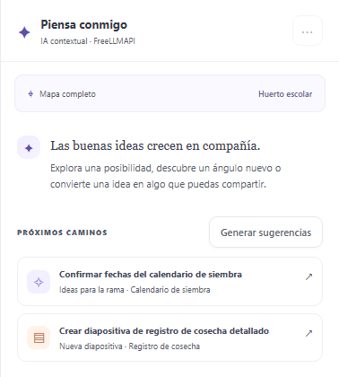
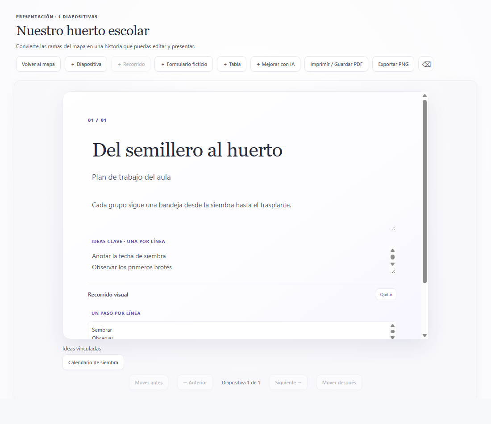

# MapaMental · Espacio Visual

[Español](README.md) · [Français](README.fr.md) · **English**

Espacio Visual is a Windows application for turning ideas into mind maps and editable presentations. Select a branch and the assistant suggests what to explore next. A suggestion can become a new idea, a table or a slide. You decide which changes to keep.



[Installation](#installation) · [First map](#from-map-to-presentation) · [AI setup](#connect-a-model) · [User guide and FAQ](docs/guia/en.md)

## From map to presentation

**1. Map out an idea.** Choose **＋ Proyecto** (new project) and create “Our school garden”. On the empty canvas, choose **＋ Añadir idea** to create the central idea and double-click to name it. Select it and use **＋ Añadir idea** to add three branches for the planting calendar, watering rota and harvest log. Double-click a card to rename it. You can work without AI.

**2. Find the next step.** With a provider active, choose **Generar sugerencias** in the *Piensa conmigo* panel. For this map, FreeLLMAPI suggested confirming the planting dates and creating a harvest log slide. Each card names the branch it affects. Select one to request a draft, review what will change and decide whether to apply it. You can undo the most recent AI change while its revision is current.



**3. Prepare something to share.** Choose **Crear presentación** to group your ideas into slides locally or request an AI draft. In the editor you can reorder slides, edit text and add tables, sequences or sample forms with fictional data. **Imprimir / Guardar PDF** exports the entire deck. **Exportar PNG** saves the current slide.



## Installation

Choose the option that matches your files. The interface opens in your browser and the service runs on your computer.

| What you have | How to start on Windows 10/11 x64 |
| --- | --- |
| An `EspacioVisual-*-Setup-x64.exe` installer | Run the installer for your Windows account and open **Espacio Visual** from the Start menu. |
| A portable ZIP package | Extract the entire archive to a local folder and run `scripts\start-windows.cmd`. Node.js is included. |
| A copy of the repository | Install Node.js 24 with npm and follow the steps below. GitHub’s source code ZIP belongs in this category. |

### Run from source

With Git installed, run these commands in PowerShell.

```powershell
git clone https://github.com/elkangri23/MapaMental.git
cd MapaMental
npm ci
npm run dev
```

If you already have the repository, start with `npm ci` in its root folder. Open `http://localhost:5173` once Vite is ready. To use the local production build, stop the development server with **Ctrl+C**, then run the following commands.

```powershell
npm run build
.\scripts\start-local.ps1
```

### Save, update and recover

Wait for **Guardado local** before closing. Stop the portable package with `scripts\stop-windows.cmd`. To stop the production launcher when running from source, use `.\scripts\start-local.ps1 -Stop`. To update, run the new installer or extract the new ZIP to another folder. Projects are stored separately under `Documents\EspacioVisual\Proyectos` in your user folder. Open **Copias** to restore an earlier revision.

## Connect a model

Open **⚙ Proveedores de IA**, create a profile, enter the model and choose **Probar conexión**. Select the model ID advertised by the service and choose **Guardar**. To check generation, return to the map and request suggestions.

| Provider | Setup |
| --- | --- |
| **FreeLLMAPI** | Start the gateway, choose **Compatible con OpenAI** and use `http://127.0.0.1:31415/v1`. When running from source, copy `.env.example` to `.env` if it doesn’t already exist and set `FREELLMAPI_API_KEY` on your computer. |
| **Ollama** | Download a model and start the local service at `http://127.0.0.1:11434`. |
| **LM Studio** | Load a model and start the local server at `http://127.0.0.1:1234`. |
| **OpenAI and Anthropic** | Select the corresponding provider and enter your key in settings. |
| **Other OpenAI-compatible services** | Enter the base URL, model ID and any required credential. Use HTTPS for remote services. |

**Privacy.** Maps and backups are saved on your computer. Before sending a request, open **Ver contexto** to review what the model will receive. FreeLLMAPI can forward data to a remote provider even when the gateway address is local. Keep the development key in your private `.env` file. Keys entered in settings are stored in Windows Credential Manager.

## License

MapaMental is distributed under the **GNU AGPLv3 only**. You may use, modify and redistribute it, and offer hosted services, including for commercial purposes. If you distribute a modified version or run it as a network service, the AGPL requires you to offer the corresponding source code under the same license. Preserve the `elkangri23` author attribution.

The license covers the original project code, documentation and images. Dependencies retain their respective licenses. Read [LICENSE](LICENSE) and [COPYRIGHT](COPYRIGHT).

## Help and project status

The **?** button opens the same manual available here, including when offline. The language selector changes the guide language. Editor controls are in Spanish.

| Language | Overview and installation | User guide and FAQ |
| --- | --- | --- |
| Español | [Inicio](README.md) | [Guía de Espacio Visual](docs/guia/es.md) |
| Français | [Présentation et installation](README.fr.md) | [Guide d’utilisation](docs/guia/fr.md) |
| English | [Overview](README.en.md) | [User guide](docs/guia/en.md) |

**Version 0.1.x, in development.** Mind maps, suggestions, slide editing and PDF/PNG export are implemented. Suggestions have been evaluated with real models through FreeLLMAPI. Full acceptance with local Ollama and LM Studio models, manual accessibility review and parts of the installer walkthrough remain open. Protected mode with OIDC, passkeys and TOTP recovery is experimental.

Development records are maintained in Spanish. See the [technical index](docs/INDEX.md), [project status](docs/STATUS.md) and [task list](docs/TASKS.md).
