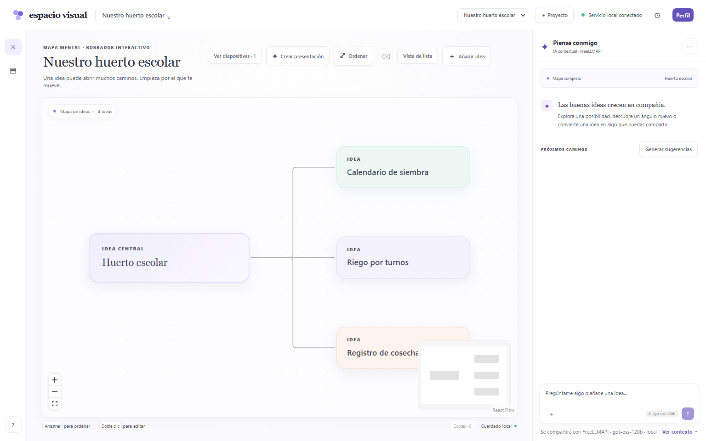
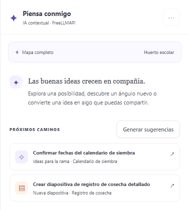
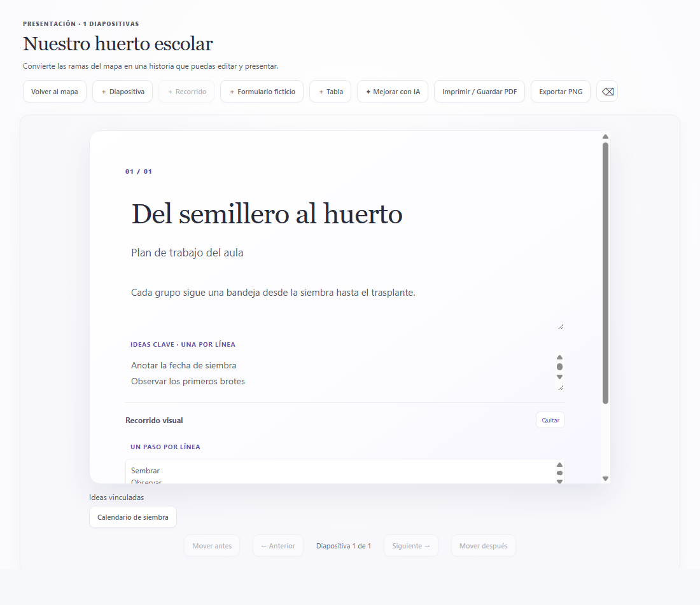

# MapaMental · Espacio Visual

[Español](README.md) · **Français** · [English](README.en.md)

Espacio Visual est une application Windows qui transforme vos idées en cartes mentales et en présentations modifiables. Sélectionnez une branche pour que l’assistant vous propose une piste à explorer. Une suggestion peut devenir une nouvelle idée, un tableau ou une diapositive. Vous choisissez les modifications à intégrer au projet.



[Installation](#installation) · [Première carte](#de-la-carte-à-la-présentation) · [Configurer l’IA](#connecter-un-modèle) · [Guide et questions fréquentes](docs/guia/fr.md)

## De la carte à la présentation

**1. Organisez vos idées.** Choisissez **＋ Proyecto** (nouveau projet) et créez « Notre potager scolaire ». Sur la carte vide, cliquez sur **＋ Añadir idea** pour créer l’idée centrale et double-cliquez pour la nommer. Sélectionnez-la, puis utilisez **＋ Añadir idea** pour créer trois branches consacrées au calendrier des semis, aux tours d’arrosage et au suivi des récoltes. Double-cliquez sur une idée pour la renommer. Vous pouvez travailler sans IA.

**2. Choisissez la prochaine étape.** Une fois le fournisseur activé, cliquez sur **Generar sugerencias** dans le panneau *Piensa conmigo*. Pour cette carte, FreeLLMAPI a proposé de confirmer les dates des semis et de créer une diapositive de suivi des récoltes. Chaque suggestion indique la branche concernée. Cliquez pour obtenir un brouillon, examinez les modifications, puis décidez de les appliquer. Vous pouvez annuler la dernière modification de l’IA tant que sa révision est active.



**3. Préparez une présentation à partager.** Avec **Crear presentación**, regroupez les idées localement ou demandez un brouillon à l’IA. Dans l’éditeur, réorganisez les diapositives, modifiez le texte ou ajoutez des tableaux, des parcours ou des formulaires illustrés de données fictives. **Imprimir / Guardar PDF** exporte toute la présentation. **Exportar PNG** enregistre la diapositive actuelle.



## Installation

Choisissez la méthode correspondant aux fichiers dont vous disposez. L’interface s’ouvre dans votre navigateur et le service s’exécute sur votre ordinateur.

| Ce que vous avez | Démarrer sous Windows 10/11 x64 |
| --- | --- |
| Un installateur `EspacioVisual-*-Setup-x64.exe` | Lancez l’installation pour votre compte, puis ouvrez **Espacio Visual** depuis le menu Démarrer. |
| Le paquet ZIP portable | Extrayez tout le contenu dans un dossier local et exécutez `scripts\start-windows.cmd`. Node.js est inclus. |
| Une copie du dépôt | Installez Node.js 24 avec npm et suivez les étapes ci-dessous. Le ZIP du code source proposé par GitHub correspond à cette méthode. |

### À partir du code source

Dans PowerShell, avec Git installé, exécutez les commandes suivantes.

```powershell
git clone https://github.com/elkangri23/MapaMental.git
cd MapaMental
npm ci
npm run dev
```

Si vous avez déjà le dépôt, commencez par `npm ci` à sa racine. Ouvrez `http://localhost:5173` lorsque Vite est prêt. Pour utiliser la version de production locale, arrêtez le serveur de développement avec **Ctrl+C**, puis exécutez les commandes suivantes.

```powershell
npm run build
.\scripts\start-local.ps1
```

### Enregistrer, mettre à jour et restaurer

Attendez **Guardado local** avant de fermer. Arrêtez le paquet portable avec `scripts\stop-windows.cmd`. Pour arrêter la version de production lancée depuis le dépôt, utilisez `.\scripts\start-local.ps1 -Stop`. Pour mettre à jour, exécutez le nouvel installateur ou extrayez le nouveau ZIP dans un autre dossier. Les projets sont stockés séparément dans `Documents\EspacioVisual\Proyectos`, sous votre dossier utilisateur. Ouvrez **Copias** pour restaurer une révision.

## Connecter un modèle

Ouvrez **⚙ Proveedores de IA**, créez un profil, renseignez le modèle et cliquez sur **Probar conexión**. Choisissez l’identifiant publié par le service, puis cliquez sur **Guardar**. Pour vérifier la génération, revenez à la carte et demandez des suggestions.

| Fournisseur | Configuration |
| --- | --- |
| **FreeLLMAPI** | Démarrez la passerelle, choisissez **Compatible con OpenAI** et utilisez `http://127.0.0.1:31415/v1`. Si vous travaillez à partir du dépôt et que `.env` n’existe pas, copiez `.env.example` dans `.env` et renseignez `FREELLMAPI_API_KEY` sur votre ordinateur. |
| **Ollama** | Téléchargez un modèle et démarrez le service local à l’adresse `http://127.0.0.1:11434`. |
| **LM Studio** | Chargez un modèle et activez le serveur local à l’adresse `http://127.0.0.1:1234`. |
| **OpenAI et Anthropic** | Choisissez le fournisseur correspondant et saisissez votre clé dans les paramètres. |
| **Autre service compatible avec OpenAI** | Renseignez l’URL de base, l’identifiant du modèle et les informations d’identification requises. Pour un service distant, utilisez HTTPS. |

**Confidentialité.** La carte et les sauvegardes restent sur votre ordinateur. Avant une demande, ouvrez **Ver contexto** pour examiner ce qui sera transmis. FreeLLMAPI peut relayer les données à un fournisseur distant même si son adresse est locale. Conservez votre clé de développement dans votre fichier `.env` privé. Les clés saisies dans les paramètres sont conservées dans le Gestionnaire d’informations d’identification de Windows.

## Aide et avancement du projet

Le bouton **?** ouvre le même guide que celui du dépôt, même hors connexion. Vous pouvez y choisir la langue de l’aide. Les commandes de l’éditeur sont en espagnol.

| Langue | Présentation et installation | Guide et questions fréquentes |
| --- | --- | --- |
| Español | [Inicio](README.md) | [Guía de Espacio Visual](docs/guia/es.md) |
| Français | [Accueil](README.fr.md) | [Guide d’utilisation](docs/guia/fr.md) |
| English | [Overview and installation](README.en.md) | [User guide](docs/guia/en.md) |

**Version 0.1.x en développement.** Les cartes, les suggestions, l’éditeur de diapositives et l’export PDF/PNG sont disponibles. Les suggestions ont été évaluées avec des modèles réels via FreeLLMAPI. La validation complète avec Ollama et LM Studio en local, la revue manuelle d’accessibilité et certaines vérifications de l’installateur restent à terminer. Le mode protégé avec OIDC, clés d’accès et récupération TOTP est expérimental.

Les documents de suivi du développement sont tenus en espagnol. Consultez l’[index technique](docs/INDEX.md), l’[état du projet](docs/STATUS.md) et les [tâches](docs/TASKS.md).
