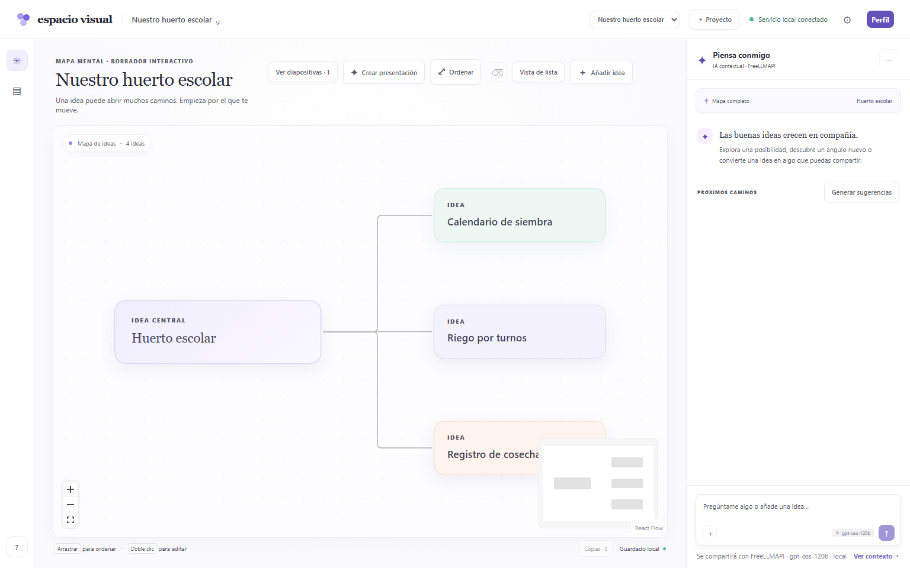
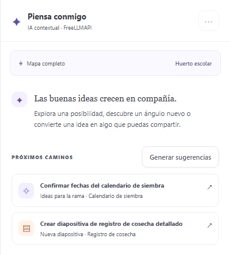
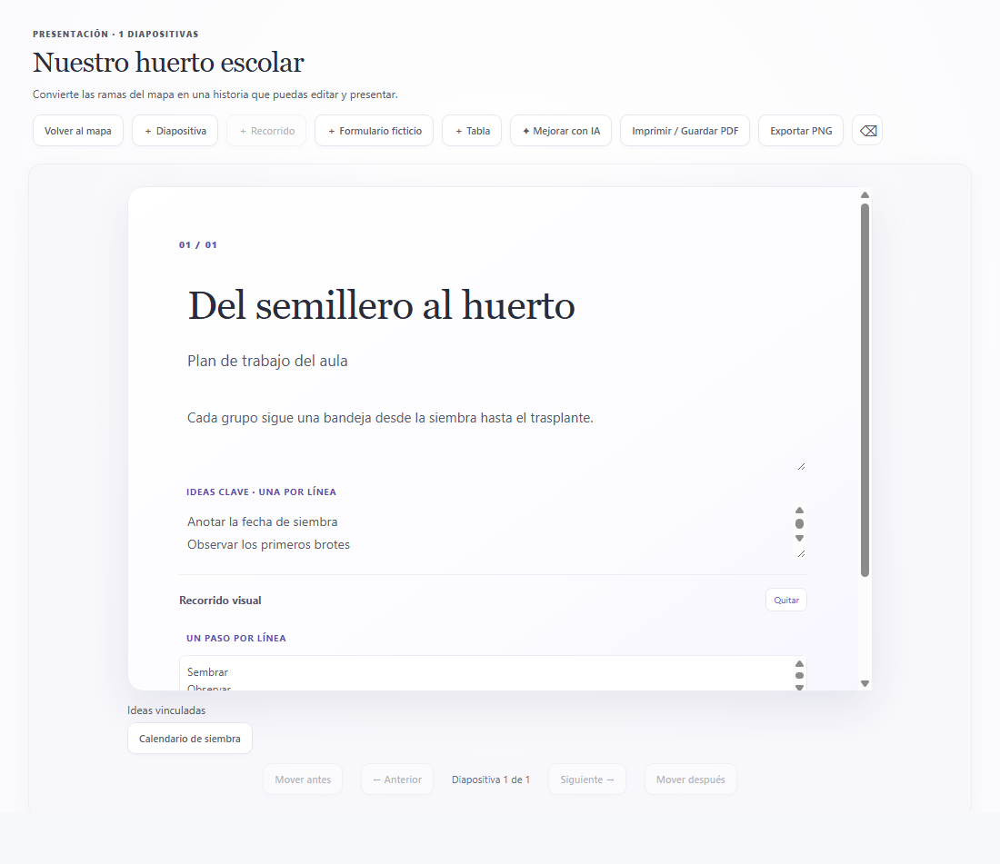

# MapaMental · Espacio Visual

**Español** · [Français](README.fr.md) · [English](README.en.md)

Espacio Visual es una aplicación para Windows que convierte ideas en mapas mentales y presentaciones editables. Selecciona una rama y el asistente te propone qué desarrollar a continuación. Puedes convertir una sugerencia en nuevas ideas, una tabla o una diapositiva. Tú decides qué entra en el proyecto.



[Instalación](#instalación) · [Primer mapa](#del-mapa-a-la-presentación) · [Configurar la IA](#conectar-un-modelo) · [Manual y preguntas frecuentes](docs/guia/es.md)

## Del mapa a la presentación

**1. Organiza la idea.** Pulsa **＋ Proyecto** y crea «Nuestro huerto escolar». En el lienzo vacío, pulsa **＋ Añadir idea** para crear la idea central y dale nombre con doble clic. Selecciónala y usa **＋ Añadir idea** para abrir tres ramas: calendario de siembra, riego por turnos y registro de cosecha. Haz doble clic en una tarjeta para renombrarla. Puedes trabajar sin IA.

**2. Encuentra el siguiente paso.** Con un proveedor activo, pulsa **Generar sugerencias** en el panel *Piensa conmigo*. En este mapa, FreeLLMAPI propuso confirmar las fechas del calendario y crear una diapositiva para el registro de cosecha. Cada tarjeta identifica la rama de destino. Pulsa una para pedir un borrador, revisa qué cambiará y decide si aplicarlo. La última operación de IA se puede deshacer mientras siga vigente su revisión.



**3. Prepara algo que puedas compartir.** Pulsa **Crear presentación** para agrupar las ideas del mapa localmente o pedir un borrador a la IA. En el editor puedes ordenar diapositivas, cambiar el texto y añadir tablas, recorridos o formularios con datos ficticios. **Imprimir / Guardar PDF** exporta la presentación completa. **Exportar PNG** guarda la diapositiva actual.



## Instalación

Elige la opción que corresponda a lo que tengas. La interfaz se abre en el navegador y el servicio se ejecuta en tu equipo.

| Si tienes… | Cómo empezar en Windows 10/11 x64 |
| --- | --- |
| Un instalador `EspacioVisual-*-Setup-x64.exe` | Ejecuta el instalador para tu usuario y abre **Espacio Visual** desde Inicio. |
| Un paquete ZIP portátil | Extrae todo el contenido en una carpeta local y ejecuta `scripts\start-windows.cmd`. El paquete incluye Node.js. |
| Una copia del repositorio | Instala Node.js 24 con npm y sigue los pasos de abajo. El ZIP de código de GitHub corresponde a esta opción. |

### Desde el código fuente

Ejecuta en PowerShell, con Git instalado:

```powershell
git clone https://github.com/elkangri23/MapaMental.git
cd MapaMental
npm ci
npm run dev
```

Si ya tienes el repositorio, empieza con `npm ci` en su carpeta raíz. Abre `http://localhost:5173` cuando Vite indique que está listo. Para usar la compilación de producción local, detén el modo de desarrollo con **Ctrl+C** y ejecuta:

```powershell
npm run build
.\scripts\start-local.ps1
```

### Guardar, actualizar y recuperar

Espera a **Guardado local** antes de cerrar. El paquete portátil se detiene con `scripts\stop-windows.cmd`; desde el código usa `.\scripts\start-local.ps1 -Stop` para detener el lanzador de producción. Para actualizar, ejecuta el instalador nuevo o extrae el ZIP nuevo en otra carpeta. Los proyectos se guardan por separado, en `Documents\EspacioVisual\Proyectos` dentro de tu carpeta de usuario. Abre **Copias** para restaurar una revisión anterior.

## Conectar un modelo

Abre **⚙ Proveedores de IA**, crea un perfil, introduce el modelo y pulsa **Probar conexión**. Elige el identificador que publique el servicio y pulsa **Guardar**. Para comprobar una generación, vuelve al mapa y pide sugerencias.

| Proveedor | Configuración |
| --- | --- |
| **FreeLLMAPI** | Inicia el gateway, elige **Compatible con OpenAI** y usa `http://127.0.0.1:31415/v1`. En una copia del repositorio, crea `.env` a partir de `.env.example` si aún no existe y rellena `FREELLMAPI_API_KEY` en tu equipo. |
| **Ollama** | Descarga un modelo e inicia el servicio local en `http://127.0.0.1:11434`. |
| **LM Studio** | Carga un modelo y activa el servidor local en `http://127.0.0.1:1234`. |
| **OpenAI y Anthropic** | Elige el proveedor correspondiente e introduce tu clave en Ajustes. |
| **Otro servicio compatible con OpenAI** | Introduce su URL base, el identificador del modelo y la credencial que requiera. Para servicios remotos, usa HTTPS. |

**Privacidad.** El mapa y las copias se guardan en tu equipo. Antes de enviar una petición, abre **Ver contexto** para revisar lo que recibirá el modelo. FreeLLMAPI puede reenviar datos a un proveedor remoto aunque su dirección sea local. Guarda la clave de desarrollo en tu `.env` privado. Las claves introducidas en Ajustes se conservan en el almacén de credenciales de Windows.

## Licencia

MapaMental se distribuye bajo **GNU AGPLv3 únicamente**. Puedes usarlo, modificarlo, redistribuirlo y ofrecer servicios alojados, incluso con fines comerciales. Si distribuyes una versión modificada o ejecutas esa versión como servicio de red, la AGPL exige ofrecer su código fuente correspondiente bajo la misma licencia. Conserva el aviso de autoría de `elkangri23`.

La licencia cubre el código, la documentación y las imágenes originales del proyecto. Las dependencias conservan sus respectivas licencias. Consulta el texto completo en [LICENSE](LICENSE) y los avisos en [COPYRIGHT](COPYRIGHT).

## Ayuda y estado del proyecto

El botón **?** de la aplicación abre el mismo manual disponible aquí, también sin conexión. El selector cambia el idioma de la ayuda. Los controles del editor están en español.

| Idioma | Presentación e instalación | Manual de uso y preguntas frecuentes |
| --- | --- | --- |
| Español | [Inicio](README.md) | [Guía de Espacio Visual](docs/guia/es.md) |
| Français | [Présentation et installation](README.fr.md) | [Guide d’utilisation](docs/guia/fr.md) |
| English | [Overview and installation](README.en.md) | [User guide](docs/guia/en.md) |

**Versión 0.1.x en desarrollo.** Los mapas, las sugerencias, el editor de presentaciones y la exportación PDF/PNG están implementados. Las sugerencias se han evaluado con modelos reales mediante FreeLLMAPI. La aceptación completa con Ollama y LM Studio locales, la revisión manual de accesibilidad y parte del recorrido del instalador siguen abiertas. El modo protegido con OIDC, passkeys y recuperación TOTP es experimental.

Para trabajar en el proyecto, consulta el [índice técnico](docs/INDEX.md), el [estado actual](docs/STATUS.md) y la [lista de tareas](docs/TASKS.md).
