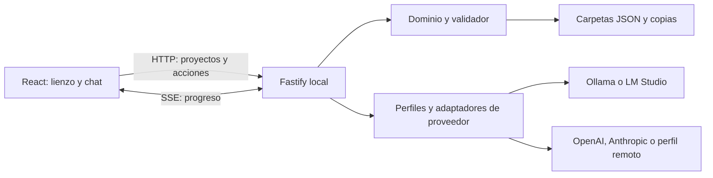

# Arquitectura

**Estado:** arquitectura acordada; UI conectada a persistencia JSON, recuperación manual, perfiles de proveedor y un primer ciclo de chat/propuesta/aplicación/deshacer. El historial se guarda en el proyecto y el progreso llega por SSE; T-011 tiene editor/visor, bloques visuales y exportación PDF nativa verificada. Los errores JSON y SSE usan el contrato de ADR-0014.

## Componentes

- **Web:** React y TypeScript con Vite. React Flow (`@xyflow/react`) aporta interacción de nodos, conexiones, selección, zoom y desplazamiento. La aplicación define su propio estilo y tipos de nodo.
- **Servicio local:** Node.js 24 LTS con Fastify. El servicio escucha solo en loopback, expone API de sesión/proyectos/IA, sirve la SPA compilada en producción, guarda proyectos y se conecta a los proveedores configurados.
- **Dominio compartido:** `packages/domain` compila a JavaScript y declaraciones TypeScript en `dist`; el build raíz lo ejecuta antes que web y servidor. Contiene el contrato JSON v3 de proyectos/mapas/diapositivas y sus validadores. `ProjectDocument` es el formato persistido canónico (ADR-0015); vistas conceptuales no cambian el archivo sin una nueva versión/migración.
- **Persistencia:** carpetas de proyecto con JSON versionado (actual v3), migraciones desde 0, 1 y 2 a 3, copias rotativas. En Windows, el servicio valida al inicio que la raíz esté en un volumen local fijo y rechaza UNC, red, USB/SD/MMC y buses no reconocidos (ADR-0017). El último cambio IA añade un inverso mínimo persistido. Los perfiles viven en `%APPDATA%\EspacioVisual\providers.json`; las credenciales quedan en Windows Credential Manager mediante `@napi-rs/keyring`, nunca en el proyecto ni en respuestas de configuración.

## Límites entre componentes

El navegador no escribe directamente en el sistema de archivos ni contiene claves de proveedor. El chat solo devuelve texto y sugerencias; al pulsar una sugerencia, el servidor genera una propuesta de nuevas ideas dentro de la rama seleccionada. La UI la previsualiza y el usuario decide si aplicarla. El servidor comprueba revisión base, IDs y alcance; guarda toda la adición junta. Se puede deshacer la última operación mientras no exista una edición posterior.

Las peticiones de chat/sugerencias incluyen el ámbito seleccionado y hasta diez mensajes recientes, limitados a 3.000 caracteres cada uno; al ejecutar una tarjeta de sugerencia se envía la instrucción sin ese historial. `buildProjectAiContext` construye el mismo payload para cliente y servidor: nodos/conexiones del ámbito, hasta 50 ancestros, títulos y fragmentos de hasta 20 diapositivas vinculadas (500 caracteres por diapositiva, 6.000 totales), conteos globales y número de ideas fuera de contexto. La vista previa expone los fragmentos; no se incluyen contenidos de diapositivas ajenas al ámbito ni existe aún un resumen narrativo global. La interfaz también muestra el historial exacto que comparte y sus recortes. Los errores API actuales devuelven `{message}`; algunos logs 5xx usan `request.id` y código/nombre del error, sin registrar prompts ni credenciales. No existe todavía la secuencia correlacionada de proveedor, validación, commit y guardado del diseño. Los perfiles se vuelven a validar desde el archivo antes de usarlos, y el socket del cliente HTTP se fija a las direcciones públicas que el servidor acaba de resolver.

El inventario de diferencias entre los contratos aprobados y el comportamiento implementado está en el [informe de deriva](2026-11-16_DRIFT_REPORT.md). En particular, el almacenamiento actual sí abre proyectos de esquema futuro en solo lectura y el contrato serializado del dominio usa nodos de React Flow, `conversation` y campos planos de diapositiva.

## Contratos locales

- `GET /api/health`: estado del servicio.
- `GET /api/projects` y `POST /api/projects`: listar y crear proyecto.
- `GET /api/projects/:id` y `PUT /api/projects/:id`: abrir y guardar con revisión.
- `POST /api/projects/:id/ai/chat`: respuesta contextual y sugerencias.
- `POST /api/projects/:id/ai/proposals`: generar propuesta de ideas en una rama.
- `POST /api/projects/:id/ai-actions`: validar y aplicar la propuesta a una revisión.
- `POST /api/projects/:id/undo-last-ai`: deshacer la última operación IA si no hubo una edición posterior.
- `/api/providers`: perfiles, comprobación de conexión, selección y límites.

Las rutas de proyecto, proveedor y operaciones IA aplican host/origen, cookie de sesión y JSON en mutaciones. Los errores JSON se normalizan como `{code,message,correlationId}`; el ID correlaciona con `reqId` local y mensajes 5xx se redactan. Los errores terminales SSE comparten el contrato (ADR-0014). La sesión local de ADR-0009 y la protegida tienen tipos y cookies separados; el modo se selecciona mediante `MYMAP_AUTH_MODE`. El modo `protected` requiere cookie protegida y rechaza el intercambio del nonce local. Desde una sesión local, Ajustes guarda issuer/client ID en `%APPDATA%\EspacioVisual\auth.json` e inicia la vinculación. `openid-client` gestiona discovery, Authorization Code + PKCE S256 y validación de state/nonce/ID Token; la etapa de login emite solo una cookie temporal OIDC. Los tokens no se persisten y las peticiones OIDC usan el control de egreso con DNS/IP fijados. WebAuthn ya puede registrar una credencial inicial y autenticar tras OIDC, con UV requerido y challenge en memoria de un solo uso. Tras verificación correcta se emite la sesión protegida. El servicio escucha solo en `::1`, el lanzador abre `localhost` para el RP ID y el callback OIDC usa `[::1]` con un intercambio temporal de estado entre orígenes loopback. T-025 implementa parcialmente varias passkeys, listado y cambio de nombre/revocación tras reautenticación reciente. T-023 implementa parcialmente TOTP con secreto/estado anti-replay en Windows Credential Manager; la recuperación emite una cookie de cinco minutos limitada al registro de una passkey que revoca las anteriores, sin guardas generales de proyecto/proveedor/IA. Faltan recorridos reales con IdP y autenticadores. Los adaptadores implementados envían solicitudes no streaming a OpenAI, Anthropic, Ollama y APIs compatibles. La cancelación de la UI cierra la petición y el servidor propaga una señal para abortar la llamada HTTP al proveedor. Esto detiene la espera/transmisión HTTP de la app, pero el servicio de modelo puede mantener cómputo interno. En Chrome se verificó el cierre del HTTP con un proveedor lento simulado, antes de recibir cabeceras y mientras se leía el cuerpo. La interfaz muestra el estado local junto al compositor. La UI y API se recorrieron con un Ollama simulado; los proveedores reales no se han validado. El historial del chat se guarda mediante el autosave del documento. Los endpoints de generación devuelven etapas y un evento terminal por SSE sobre la misma petición POST. Los adaptadores esperan la respuesta completa del modelo antes de validarla. El lienzo expone edición, organización y eliminación de ramas con confirmación; se recorrió un grafo compartido/cíclico y la persistencia tras reinicio. El informe actual de seguridad y sus límites está en [`reviews/2026-11-15-security-audit.md`](reviews/2026-11-15-security-audit.md).

