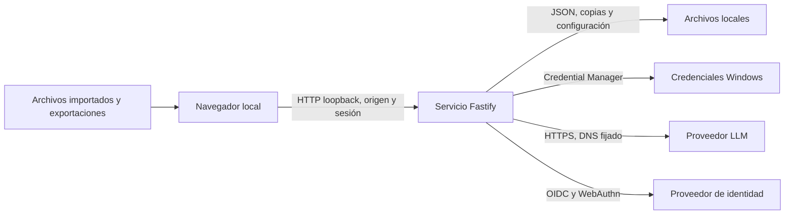

# Modelo inicial de amenazas

**Fecha:** 2026-11-17
**Ámbito:** aplicación personal Espacio Visual / MapaMental, ejecución local en Windows
**Estado:** modelo inicial basado en arquitectura y controles implementados; pendiente revisión dinámica completa. No es una certificación ni un pentest.

## Objetivo y límites

Este documento identifica activos, límites de confianza, adversarios y escenarios de abuso para orientar T-015. La app está diseñada para una persona, con el servicio ligado a loopback y datos persistidos en el equipo. El modo protegido OIDC es opcional; el modo local es el predeterminado. La verificación de controles se apoya en revisión de código y escenarios aislados descritos en [`VERIFICATION.md`](VERIFICATION.md).

Fuera del alcance: seguridad de Windows, del navegador o del proveedor LLM; seguridad física del equipo; análisis de malware; disponibilidad de terceros; protección frente a un atacante con permisos de la misma cuenta o de administrador. El loopback reduce la exposición de red, pero no constituye una frontera contra procesos locales comprometidos.

## Activos que requieren protección

| Activo | Contenido | Impacto si se expone o altera |
|---|---|---|
| Proyectos | Ideas, relaciones, chat guardado, diapositivas, tablas y formularios ficticios | Divulgación, pérdida o manipulación del trabajo |
| Credenciales de proveedores | Claves de OpenAI, Anthropic y servicios compatibles | Gasto, acceso no autorizado y exposición de datos enviados |
| Identidad y autenticación | Perfil, configuración OIDC, credenciales passkey, secreto TOTP y sesiones | Suplantación, bloqueo de la persona propietaria o pérdida de acceso |
| Contexto enviado a IA | Mensaje, selección del mapa, resumen estructural y fragmentos de diapositivas vinculadas | Divulgación a un proveedor remoto seleccionado |
| Configuración y presupuestos | URLs, modelos, tarifas, límites y uso acumulado | Redirección del tráfico, gasto inesperado o pérdida de controles |
| Registros | Eventos técnicos y de seguridad | Exposición de metadatos o pérdida de capacidad de investigación |
| Integridad de la instalación | Ejecutables, dependencias y configuración local | Ejecución de código no confiable o alteración del comportamiento |

## Límites de confianza

- **Navegador ↔ servicio:** el navegador y el proceso comparten equipo, pero el navegador controla el origen de las peticiones. Host/origen, cookie y nonce restringen solicitudes web no autorizadas.
- **Servicio ↔ almacenamiento local:** el proceso tiene los permisos de la cuenta que lo inició. Los proyectos son JSON; la clave del proveedor se guarda aparte en Credential Manager.
- **Servicio ↔ LLM:** el proveedor configurado es externo al límite local. Al usarlo, recibe el prompt y el contexto mostrado en la vista previa.
- **Servicio ↔ IdP:** solo aplica con `MYMAP_AUTH_MODE=protected`; depende de disponibilidad y seguridad del IdP.
- **Archivos/exportaciones:** los proyectos guardados y las respuestas del modelo se consideran no confiables hasta validarse; los PDF/PNG exportados pueden contener información del proyecto.

## Adversarios considerados

1. **Página web maliciosa:** intenta usar el navegador para enviar peticiones al servicio de loopback o leer sus respuestas.
2. **Proceso local no privilegiado:** intenta descubrir o abusar del puerto local, cambiar archivos de configuración o agotar recursos.
3. **Proveedor LLM o IdP comprometido/malicioso:** devuelve contenido hostil, redirige solicitudes o intenta aprovechar confianza excesiva.
4. **Archivo de proyecto manipulado:** contiene JSON malformado, relaciones inválidas, tamaños extremos o un esquema futuro.
5. **Atacante con la cuenta de Windows o administrador:** puede leer memoria/archivos, usar Credential Manager y alterar la instalación; no se considera contenido por los controles de la aplicación.

## Escenarios y controles

| ID / amenaza | Prioridad inicial | Controles actuales y evidencia | Riesgo residual / trabajo |
|---|---|---|---|
| TM-01 — Una web externa falsifica peticiones a loopback (CSRF/rebinding del navegador) | Alta | Servicio ligado a `::1`; validación exacta de Host y Origin, `Sec-Fetch-Site` y marcador de UI; nonce de un uso; cookie HttpOnly/SameSite Strict; mutaciones JSON. Escenarios de host/origen/nonce documentados en `VERIFICATION.md`. | No cubre vulnerabilidades del navegador, extensión maliciosa o proceso local. Completar matriz dinámica de host/cookie en T-015. |
| TM-02 — URL de proveedor alcanza localhost, red privada o metadata mediante SSRF | Alta | Rechazo de rangos especiales, resolución y validación de todas las IP, lookup de socket fijado, SNI explícito, TLS obligatorio, redirecciones rechazadas, timeout y respuesta máxima. Pruebas de loopback, IANA, redirección y simulación DNS; la ruta HTTP de prueba de proveedores rechazó `127.0.0.1.nip.io` con HTTP 400 y cero conexiones al listener. | La carrera entre la respuesta DNS validada y el lookup del socket solo está cubierta por la simulación determinista, no por una petición HTTP que fuerce el cambio. También falta cobertura completa de prefijos y prueba con proveedores reales en Windows. |
| TM-03 — Contenido del proyecto se divulga a un proveedor remoto | Alta | Envío solo al usar proveedor; la UI muestra proveedor, modelo, ámbito, resumen, fragmentos e historial enviados. El contexto limita selección, cantidad y longitud. | El proveedor remoto recibe el contenido enviado y aplica sus propias políticas. No se cifra ni anonimiza semánticamente; la elección del proveedor y del contenido queda a cargo de la persona. |
| TM-04 — Robo o filtración de claves de proveedor | Alta | Los perfiles guardan claves en Windows Credential Manager; `providers.json` no almacena esas claves; logs redactan Authorization, Cookie y x-api-key; respuestas exponen solo si hay credencial configurada. Excepción: FreeLLMAPI lee `FREELLMAPI_API_KEY` desde `.env` del repositorio, excluido de Git. | La clave de `.env` es texto legible por la cuenta local. Malware/proceso bajo la misma cuenta puede abusar de secretos; la clave existe en memoria durante la petición. No se pretende proteger frente a administrador o cuenta comprometida. |
| TM-05 — Respuesta LLM induce cambios engañosos o dañinos | Alta | La salida se valida; las propuestas requieren vista previa y aplicación explícita; el servidor verifica IDs, ámbito y revisión; hay deshacer y límites de contenido. El modelo no accede al sistema de archivos. | Puede generar información falsa o inadecuada y la persona puede aceptarla. No hay verificación factual general; el contexto puede contener instrucciones hostiles del propio proyecto. |
| TM-06 — Proyecto manipulado explota parser, traversal o corrupción | Alta | UUID y validadores de documentos/grafos; límites de campos; escrituras atómicas, copias y restauración; intento de limpieza del destino si falla `copyFile`/verificación. Una inyección ENOSPC después de crear un parcial lo retiró y conservó el proyecto byte a byte; el reintento fue válido. Una ACL que denegaba añadir archivos a `backups` produjo `EPERM` sin cambiar el proyecto y el reintento funcionó al restaurarla. | Falta simular un fallo simultáneo de la limpieza (ACL/ENOSPC), además de otros escenarios ACL, fallos físicos e interrupción de restauración y límites adicionales. Los proyectos no tienen cifrado propio en reposo. |
| TM-07 — Abuso de recursos o gasto por solicitudes repetidas | Media | Límite de cuerpo 8 MiB, timeout de petición/proveedor, respuesta de proveedor 1 MiB, máximo tres generaciones simultáneas, cancelación y presupuestos por proveedor/modelo opcionales. La concurrencia se recorrió con mock. | No hay cuota diaria ni limitador general por IP/usuario; el límite de concurrencia es por proceso y no contiene el coste si el usuario deja presupuesto sin definir. |
| TM-08 — Bypass o replay de la autenticación protegida | Alta | OIDC Code + PKCE, state/nonce, validación de issuer/ID token; WebAuthn con verificación de usuario; challenges de un uso; sesiones separadas, revocación y TOTP con anti-replay/bloqueo parcial. | Implementación MFA/OIDC parcial; faltan IdP, aplicación TOTP y autenticadores reales, además de casos negativos completos. El modo local no requiere MFA. |
| TM-09 — Logs revelan prompts, tokens o datos personales | Media | Redacción de cabeceras, eliminación de query OIDC, errores genéricos; logs IA con IDs opacos y sin prompts/respuestas; registro local de seguridad limitado por edad/tamaño. | Metadatos operativos siguen existiendo; el registro es best-effort. Revisar si cambian serializadores, rutas o logger. |
| TM-10 — Manipulación de datos locales por otro proceso o fallo de almacenamiento | Media | Raíz de proyectos fija local, persistencia JSON validada, escritura durable, copias, detección de corrupción y conflicto entre pestañas. La denegación de escritura sobre la carpeta de copias conservó el proyecto y permitió reintento tras revertir la ACL. Una inyección ENOSPC después de escribir un parcial confirmó limpieza y reintento. | La misma cuenta de Windows puede modificar archivos. Falta provocar fallo de la propia limpieza y otros puntos ACL/físicos. No hay cifrado de proyectos por la app. |
| TM-11 — Cadena de suministro o instalador alterado | Media | Dependencias fijadas por lockfile; build y `npm audit --omit=dev` se han ejecutado; instalación/desinstalación aisladas recorridas. | No hay firma Authenticode ni verificación automática de origen/hash para actualización; la distribución es personal y local. Revisar antes de compartir artefactos. |

## Supuestos de seguridad

- El equipo y la cuenta interactiva de Windows son de confianza, no están comprometidos y tienen protección de disco del sistema operativo adecuada.
- El servicio no se expone por red; solo se inicia mediante los scripts/instalador previstos y se conserva la validación de volumen local.
- La persona revisa el proveedor y el contexto antes de enviar, y las propuestas IA antes de aplicarlas.
- Una URL remota debe usar HTTPS; los proveedores HTTP se limitan a loopback.
- Las funciones de autenticación protegida no se consideran listas para uso sensible hasta completar T-021/T-023–T-026.

## Prioridades de mitigación

1. Completar en T-015 una prueba HTTP que fuerce un cambio DNS entre resolución y conexión, y la matriz de errores/permisos de disco.
2. Completar pruebas negativas de OIDC/MFA/passkeys y accesibilidad de esos flujos antes de usar modo protegido como barrera de seguridad.
3. Ejecutar recorridos con proveedores reales/locales y actualizar límites de privacidad/coste según los resultados.
4. Añadir verificación de actualización y conservación de datos antes de considerar la distribución estable.

## Criterio de revisión

Revisar este modelo si cambia el alcance de loopback/usuario único, se incorpora importación de archivos externa, sincronización, acceso por red, nuevos proveedores o autenticación. La revisión actual está alineada con el estado de [`TASKS.md`](TASKS.md), [`SECURITY.md`](SECURITY.md) y [`COMPLIANCE.md`](COMPLIANCE.md); el rechazo HTTP ante una respuesta DNS privada y la simulación de pinning cubren etapas distintas, pero no equivalen a una prueba HTTP integrada de la carrera de rebinding.
