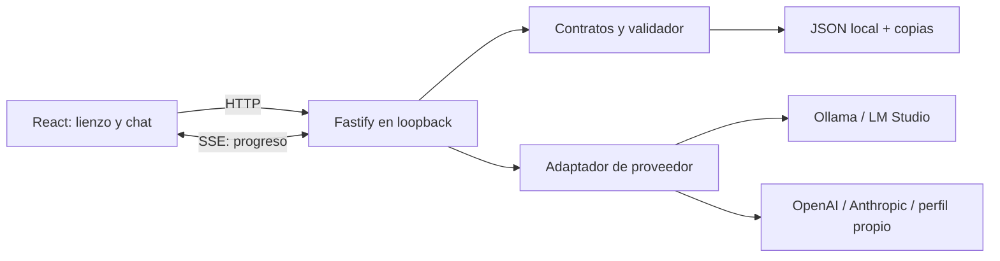

# Espacio visual personal asistido por IA

* **Autor:** Antonio Moles
* **Estado:** Revisado con Goldfish; implementación en curso
* **Fecha:** 2026-11-14

## Overview

La aplicación permitirá desarrollar ideas en mapas mentales y presentaciones editables. El usuario trabajará en un lienzo central y conversará con la IA en un panel lateral. Las sugerencias se adaptarán al proyecto y se ejecutarán al pulsarlas. Los proyectos se guardarán en el ordenador y podrán usar modelos locales o proveedores remotos configurados por el usuario. La distribución tomará como referencia el flujo de MyMap, con identidad visual propia.

## The Problem

Al desarrollar una idea, el usuario suele alternar entre conversación con IA, herramientas para organizar conceptos y herramientas para crear diapositivas. Las respuestas útiles quedan en texto y requieren trabajo manual para convertirlas en una estructura visual editable. Las sugerencias genéricas tampoco sirven si no consideran qué hay ya en el proyecto.

La aplicación reunirá ese trabajo en un proyecto visual. La IA podrá crear un mapa o presentación, ampliar una rama sin reemplazar las demás y proponer temas concretos como monetización, recorridos de uso, actores, riesgos, formularios de ejemplo y validación. El usuario decidirá qué sugerencia ejecutar. El trabajo permanecerá en archivos locales y se podrá elegir el proveedor, incluidos modelos locales.

## Goals

* Crear y editar mapas mentales y presentaciones con asistencia de IA.
* Mostrar sugerencias contextuales en el chat lateral y desarrollarlas al pulsarlas.
* Indicar el ámbito afectado, preservar contenido fuera de él y deshacer la última acción IA.
* Guardar proyectos automáticamente en el ordenador y ofrecer copias recuperables.
* Elegir OpenAI, Anthropic, LM Studio, Ollama o perfiles personalizados compatibles con OpenAI.
* Informar cuándo y qué contexto se envía a un proveedor remoto; permitir presupuesto mensual o uso sin límite.
* Presentar diapositivas en el navegador y exportar PDF multipágina y PNG de la diapositiva actual.
* Mantener lienzo central y chat lateral con estilo visual propio.

## Non-Goals

* Copiar la marca o apariencia exacta de MyMap.
* Añadir en v1 tipos de lienzo distintos de mapas mentales y presentaciones.
* Formularios funcionales, prototipos interactivos, colaboración en nube o enlaces públicos.
* Soporte específico para Strata.
* Requerir servicios de nube para abrir o guardar un proyecto.

## Open Questions

No hay decisiones de producto o arquitectura abiertas para v1. La selección del paquete de Node que use el almacén seguro de Windows es una tarea técnica sujeta a mantenimiento; no cambia el contrato del producto. Los hitos M0–M4 son entregas internas para construir y revisar partes de v1, no lanzamientos comerciales separados.

## Critical User Journeys (CUJs)

### CUJ 1: Crear y recuperar un mapa

* **Given:** la app está abierta y el usuario ha elegido un proveedor local configurado.
* **When:** escribe una idea y pide un mapa; mueve, renombra o conecta nodos; cierra y vuelve a abrir el proyecto.
* **Then:** aparece un mapa editable, los cambios se guardan localmente y se recuperan al volver a abrirlo.

### CUJ 2: Ampliar una rama con IA

* **Given:** hay un mapa y se selecciona una rama.
* **When:** el usuario escribe una petición o pulsa una sugerencia contextual.
* **Then:** la UI señala el ámbito; la IA muestra progreso; los cambios validados aparecen juntos y las demás ramas se conservan. La última operación se puede deshacer hasta que haya otra edición del lienzo.

### CUJ 3: Preparar y presentar diapositivas

* **Given:** existe un mapa con nodos útiles.
* **When:** el usuario pide crear una presentación, indicando número o dejando que la IA elija entre 3 y 7; edita y ordena el resultado.
* **Then:** cada diapositiva es una unidad del visor, se conservan referencias a nodos fuente, la navegación indica `n/N`, el PDF tiene una página por diapositiva y PNG descarga la diapositiva actual.

### CUJ 4: Configurar proveedor y presupuesto

* **Given:** el usuario está en Preferencias.
* **When:** configura Ollama, LM Studio, OpenAI, Anthropic o un perfil compatible propio; prueba conexión y opcionalmente fija presupuesto mensual.
* **Then:** se explica el proveedor activo, las credenciales se almacenan fuera del proyecto, el uso remoto indica contexto compartido y el límite bloquea nuevas peticiones al alcanzarse cuando el coste puede estimarse.

## Technical Plan (Architecture)

### Componentes

* **Web:** React + TypeScript + Vite. React Flow (`@xyflow/react`) aportará interacción de nodos, conexiones, selección, zoom y viewport; los tipos de nodo y la identidad visual serán propios.
* **Servicio local:** Node.js 24 LTS + Fastify. Se ejecutará como proceso hijo de la app bajo la cuenta Windows interactiva actual y escuchará solo en `::1`; el lanzador abrirá `http://localhost:<puerto>` para mantener el RP ID de WebAuthn. Inno Setup incluirá Node y creará un acceso directo para iniciar el proceso y abrir el navegador. Ver [ADR-0013](../decisions/ADR-0013-loopback-ipv6-y-webauthn.md).
* **Workspace:** npm workspaces con `apps/web`, `apps/server` y `packages/domain` para contratos y operaciones compartidas.
* **Persistencia:** carpetas JSON versionadas en un volumen local fijo, autosave y hasta 20 copias previas válidas. En Windows, el arranque verifica volumen fijo, local y bus reconocido; rechaza UNC, red, buses USB/SD/MMC y almacenamiento desconocido (ADR-0017). Los secretos quedarán en el almacén seguro de Windows y se aislarán por cuenta de usuario.

### Proyecto y operaciones

El modelo conceptual de proyecto contiene mapa, presentación ordenada, conversación y operaciones inversas de IA. El formato JSON persistido v3 usa literalmente `ProjectDocument`: `id`, `name`, `schemaVersion`, `revision`, `createdAt`, `updatedAt`, `map`, `presentation`, `conversation`, `suggestions`, `lastAiUndo` y estados inversos de diapositiva/presentación opcionales. `map.nodes` son nodos React Flow (`id`, `position`, `data.label` y `data.tone` opcional); `map.edges` usan `id`, `source` y `target`, y representan la jerarquía conceptual. `presentation.slides` es una lista ordenada de `PresentationSlide` con `id`, `title`, `subtitle`, `body`, `bullets`, `sourceNodeIds` y bloques opcionales `diagramSteps`, `mockFields` y `table`. Así se serializan los bloques conceptuales de texto, viñetas, diagrama estático, formulario ficticio y tabla; no se persiste un arreglo `blocks[]`. `conversation` contiene la conversación del proyecto actual. `lastAiUndo` y sus variantes guardan inversos de acciones IA. El proyecto no almacena configuración de proveedor ni credenciales. El contrato y las reglas de migración están en [ADR-0015](../decisions/ADR-0015-formato-persistido-proyecto-v3.md); todo cambio al JSON requiere una nueva versión y migración.

El modelo deberá devolver una envoltura tipada con revisión base, ámbito, operaciones y sugerencias siguientes. El servicio validará esquema, IDs, tipos, referencias y alcance. Aplicará todas las operaciones como una transacción durable; no aceptará escrituras directas del modelo ni cambios fuera del ámbito. Una respuesta inválida generará un error accionable y no se aplicará parcialmente.

La generación comunica sus etapas por SSE en la petición que inició el chat o la propuesta. Cerrar la petición cancela la generación HTTP. Aplicar una propuesta es una operación separada que incrementa la revisión y guarda un inverso. Cualquier edición posterior del lienzo invalida deshacer. La respuesta del chat puede incluir sugerencias para desarrollar al pulsarlas.

### API local

* `GET /api/health`: estado del proceso.
* `GET /api/projects`; `POST /api/projects`: listar y crear proyecto.
* `GET /api/projects/:id`; `PUT /api/projects/:id`: abrir/guardar. PUT incluirá `expectedRevision`; una revisión obsoleta devolverá `409 REVISION_CONFLICT` con la revisión actual.
* `POST /api/projects/:id/ai/chat`, `/ai/proposals` y `/ai/slides/proposals`: generación con JSON o con SSE si el cliente solicita `text/event-stream`. El flujo emite `stage` y termina con `result` o `error`. Al abortar la petición, se cierra la conexión al proveedor.
* `POST /api/projects/:id/ai/deck/proposals`: prepara una presentación con el mismo flujo. Admite de una a doce diapositivas con cantidad indicada, o de tres a siete en automático.
* `POST /api/projects/:id/ai-actions` y `/ai/slides/apply`: aplican propuestas confirmadas con revisión esperada y respuesta JSON.
* `POST /api/projects/:id/ai/deck/apply` y `/undo-last-ai-deck`: sustituyen o recuperan la presentación con revisión esperada.
* `POST /api/projects/:id/undo-last-ai`: cuerpo `{expectedRevision}`; devuelve la nueva revisión o `409 UNDO_EXPIRED` si una edición posterior invalidó el inverso.
* `/api/providers`: perfiles, conexión, modelo, tarifas y límites. Toda respuesta JSON de error usa `{code, message, correlationId}`; los eventos SSE terminales `error` incluyen el mismo contrato. Las respuestas exitosas no cambian. Véase ADR-0014.

**Seguridad de sesión propuesta:** la UI de producción y la API compartirán origen. El launcher iniciará el servidor bajo el usuario actual con un nonce de un solo uso; la UI lo intercambiará por una sesión HttpOnly/SameSite y lo quitará de la URL. Mutaciones exigirán sesión, `Origin` exacto permitido y `Host` de loopback esperado; no habrá CORS abierto. En desarrollo solo se permitirá el origen Vite local configurado. Las solicitudes con origen ausente o distinto se rechazarán.

### Proveedores, privacidad y coste

OpenAI, LM Studio, Ollama y perfiles propios compatibles usan el adaptador OpenAI-compatible; Anthropic usa su API nativa. Los perfiles personalizados solo aceptan protocolo compatible OpenAI en v1. La lista de modelos se consulta cuando el servidor lo permite o se introduce un ID manualmente. Los perfiles y las tarifas se guardan en %APPDATA%; el registro mensual de tokens y costes se guarda en `%LOCALAPPDATA%\\EspacioVisual`; secretos en el almacén de credenciales de Windows del usuario interactivo. `project.json` nunca los contiene.

Para cualquier proveedor, el contexto por defecto incluirá el elemento afectado y su cadena de ancestros, elementos relacionados de esa rama, títulos y fragmentos acotados de contenido de diapositivas relevantes, un resumen estructural global determinista (idea central y hasta ocho etiquetas de ramas, máximo 120 caracteres por etiqueta; ADR-0018) y hasta seis turnos recientes pertinentes del chat actual. Los fragmentos se limitan a 20 diapositivas, 500 caracteres por diapositiva y 6.000 en total; la UI permite inspeccionarlos antes de enviar. No incluirá claves, copias de seguridad, otros proyectos, configuración ni rutas locales. La UI identificará el proveedor y permitirá inspeccionar los elementos/resumen que se enviarán antes de enviar, sin diálogo de confirmación por petición. El contexto se reducirá para respetar la ventana del modelo; la interfaz indicará si se resumió.

El presupuesto remoto es mensual, por proveedor y en EUR; tarifas de entrada/salida por millón de tokens serán editables por modelo. La app no convertirá monedas ni calculará impuestos: mostrará una estimación basada en tarifa configurada y tokens reportados. Si hay precio y uso, bloqueará nuevas peticiones al alcanzar el límite; la petición en curso terminará. Si falta tarifa o uso, avisará que el límite no se puede garantizar y permitirá continuar según la decisión del usuario. Si un proveedor informa uso parcial de una respuesta fallida, se añadirá al registro; no habrá reintentos automáticos. Sin límite configurado, el uso seguirá disponible.

Los logs correlacionan petición, proveedor, validación, commit y guardado, pero no copian prompts ni contenido del lienzo.

### Persistencia, presentación y exportación

Cada proyecto vivirá en una carpeta bajo `Documentos\\EspacioVisual\\Proyectos` (configurable) con `project.json` y `backups/`. En Windows, antes de abrir el puerto local, el servicio resuelve el volumen efectivo de la carpeta y exige `Fixed` y un bus local reconocido, rechazando UNC, red, medios USB/SD/MMC y buses desconocidos. Si la carpeta aún no existe, inspecciona el directorio existente más cercano. El detalle operativo y la limitación de verificación por arranque están en [ADR-0017](../decisions/ADR-0017-volumen-local-para-proyectos.md). El servicio validará la nueva revisión, escribirá un temporal, sincronizará y volverá a leerlo, creará y verificará una copia del documento vigente, y después reemplazará `project.json`. Solo entonces actualizará el estado en memoria y confirmará el cambio a la UI. El fallo de disco mantendrá el documento principal y la copia anterior; no eliminará copias válidas. Tras éxito, conservará las 20 revisiones previas más recientes. Migraciones guardarán copia antes de cambiar esquema. Proyectos de esquema más nuevo se abrirán solo lectura en una app antigua.

El mapa usará nodos y conexiones jerárquicos, disposición radial inicial y posiciones guardadas tras mover nodos. La presentación será un artefacto separado y ordenado, editable, con referencias de procedencia que no sincronizarán ediciones automáticamente. Si el usuario indica cantidad, se creará exactamente ese número; si no, la IA propondrá entre 3 y 7. El visor presentará una diapositiva a la vez; el PDF contendrá una página por diapositiva y PNG exportará la actual.

## Alternatives Considered

### Solo navegador con IndexedDB y File System Access API

* **Pros:** no requiere servicio instalado.
* **Cons:** cuotas del navegador pueden variar; el selector de carpetas requiere permisos y no ofrece acceso transparente para backups/migraciones; las credenciales del proveedor quedarían en almacenamiento web.
* **Reason for Rejection:** Rejected by author: las necesidades incluyen carpetas recuperables, acceso a modelos locales y secretos de Windows. El servicio local concentra estas operaciones y permite mantener un solo formato de proyecto.

### Aplicación de escritorio empaquetada

* **Pros:** acceso nativo al sistema de archivos.
* **Cons:** requiere mantener una shell nativa, permisos y empaquetado adicionales; la UI quedaría ligada a una aplicación instalada en vez de abrirse como web local.
* **Reason for Rejection:** Rejected by author: se eligió web + servicio local porque mantiene el flujo web y permite aprovechar un backend local común para archivos y proveedores.

### Lienzo único con marcos para mapas y diapositivas

* **Pros:** imita la unidad de presentación observada en MyMap.
* **Cons:** acopla la organización del mapa al orden de las diapositivas y puede agrupar varias secciones en una página.
* **Reason for Rejection:** Rejected by author: el usuario quiere editar mapa y presentación por separado. Los IDs fuente permiten trazabilidad sin acoplar el orden del mapa al deck.

### Modelo remoto obligatorio

* **Pros:** no instala ni administra modelos locales.
* **Cons:** exige conexión y transmite contenido de los proyectos.
* **Reason for Rejection:** Rejected by author: el usuario exige Ollama y LM Studio, y quiere poder escoger entre modelos locales y remotos.

### Base de datos SQLite para cada proyecto

* **Pros:** transacciones, índices y consultas eficientes si los proyectos crecen o necesitan búsquedas complejas.
* **Cons:** exige migrar base de datos, inspeccionar y recuperar con herramientas específicas; no es legible como documento y añade trabajo para distribuir copias.
* **Reason for Rejection:** Rejected by author: v1 es de uso personal con proyectos portables y legibles. JSON versionado en carpeta facilita copiar, comparar y restaurar; el tamaño objetivo inicial es de hasta 1.000 nodos y 100 diapositivas.

### Límite por número de solicitudes

* **Pros:** fácil de contar incluso sin datos de token.
* **Cons:** una solicitud pequeña y una grande consumen lo mismo.
* **Reason for Rejection:** Rejected by author: el usuario pidió presupuesto mensual en EUR. Se calculará con tokens reportados y tarifas editables; se avisará y permitirá continuar si la estimación no está disponible.

## Risks & Mitigations

| Riesgo | Mitigación prevista |
|---|---|
| Una web ajena intenta acceder al servicio loopback | Escuchar solo en `::1`, permitir solo host/origen exactos y exigir sesión de un solo uso para mutaciones; rechazar origen ausente y no habilitar CORS abierto. |
| Secreto de proveedor expuesto a otro usuario de Windows | Ejecutar la app bajo el usuario interactivo actual; guardar claves en el almacén de credenciales asociado a esa cuenta, no en proyecto ni settings JSON. |
| Respuesta de IA añade elementos fuera del ámbito | Validar IDs, revisión base, tipos y destino; aplicar solo operación completa validada; mantener inverso de la última acción. |
| Cierre o disco lleno durante el guardado | Verificar copia previa y temporal antes de reemplazar; no confirmar UI ni actualizar memoria hasta que el archivo durable exista; no rotar copias válidas si falla el commit. |
| Proyecto dañado o formato futuro abierto por versión vieja | Mantener hasta 20 copias válidas, ofrecer recuperación explícita y abrir esquemas futuros en modo de solo lectura. |
| Servicio remoto factura distinto de la estimación | Marcarlo como estimado; usar tarifas editables y tokens informados; avisar y dejar continuar si faltan datos, indicando que el tope no se puede garantizar. |
| Contexto remoto más amplio de lo esperado | Mostrar proveedor y elementos/resumen enviados antes de cada llamada; excluir credenciales, backups, otros proyectos y rutas locales; no pedir confirmación repetitiva. |
| Modelo local tarda o se desconecta | Mostrar progreso, permitir cancelación antes del commit y conservar el documento anterior si la llamada falla. |
| Instalador reemplaza o borra datos del usuario | Guardar datos fuera de la carpeta de programa; actualizar/desinstalar solo binarios; verificar ciclo en la entrega M4. |

## Non-Functional Requirements

* **Localidad:** proyectos y secretos permanecerán en el equipo. Con un proveedor local, la app no enviará datos fuera del equipo.
* **Seguridad:** servicio solo en loopback; sesión de usuario, host/origen exactos y credenciales aisladas por cuenta; modelo sin acceso directo a archivos.
* **Recuperación:** escritura y reemplazo durable, copia previa verificada y restauración explicada con revisión/fecha.
* **Compatibilidad:** proyecto versionado, migraciones explícitas y lectura protegida de esquemas futuros.
* **Respuesta:** progreso visible; la UI reflejará una edición solo tras confirmación durable. Cancelar antes del commit no cambiará el proyecto.
* **Capacidad inicial objetivo:** hasta 1.000 nodos y 100 diapositivas en un proyecto, con guardado de un archivo de 1 MB en menos de 1 segundo en disco local SSD. Medición del 2026-11-16: `saveProject` guardó un fixture de 1.005.189 bytes, 1.000 nodos, 999 aristas y 100 diapositivas en ocho ejecuciones de 63–142 ms, incluida copia y escritura durable, sobre el entorno local C: NVMe con Node 24.22.0. No incluye serialización/transferencia HTTP y no garantiza otros equipos. El servicio devolverá confirmación de cancelación local en menos de 500 ms, aunque el proveedor puede tardar en detener cómputo; esa meta de cancelación aún no se ha medido.
* **Diagnóstico:** errores separados para conexión, modelo, validación, aplicación y guardado; no registrar prompts.

## Future Improvements

* Importar texto/PDF, exportación SVG/PPTX, temas adicionales y más diagramas.
* Perfiles de proveedor extensibles a otros protocolos.
* Búsqueda local dentro de varios proyectos y copias en otra unidad.
* Explorar colaboración solo si el uso personal lo requiere.

## Detailed Implementation Plan

La lista describe el objetivo de v1 y debe leerse junto con `docs/TASKS.md` para conocer el progreso. Ya existen la shell, persistencia recuperable, edición de mapas, perfiles de proveedor y un flujo inicial de chat/sugerencias/propuesta de ideas con aplicación explícita y deshacer. La revisión de seguridad del 2026-11-15 está en `docs/reviews/2026-11-15-security-audit.md`: fijación DNS, validación de configuración/documentos, errores genéricos y controles de carga implementados; recorridos negativos, proveedor real y validación del instalador de Windows siguen pendientes. T-011 ofrece diapositivas derivadas del mapa, bloques visuales estáticos, plantilla de impresión completa, propuesta IA revisable con deshacer y exportación PNG de la diapositiva actual. Se recorrieron IA y PNG en Chromium con configuración temporal; el PDF nativo final de tres páginas se guardó, se renderizó y se inspeccionó como archivo etiquetado con orden lógico y contenido sin cortes visibles. La evaluación con lector de pantalla real continúa en T-016. Ollama simulado valida el cableado, no calidad ni compatibilidad completa de un modelo real. Los hitos son cortes internos de implementación, no versiones comerciales separadas.

### Lista única de implementación

| Fase / tarea | Archivos y operación | Criterio de salida |
|---|---|---|
| **M0 — T-003/T-004/T-006: diseño, docs y shell** | **Modificar:** `package.json`, `package-lock.json`, `tsconfig.base.json`, `.gitignore`, `AGENTS.md`, `README.md`, `CHANGELOG.md`; `apps/web/package.json`, `apps/web/index.html`, `apps/web/tsconfig.json`, `apps/web/vite.config.ts`, `apps/web/src/main.tsx`, `apps/web/src/App.tsx`, `apps/web/src/styles.css`; `apps/server/package.json`, `apps/server/tsconfig.json`, `apps/server/src/index.ts`, `apps/server/src/routes/health.ts`; `packages/domain/package.json`, `packages/domain/src/index.ts`. **Crear:** `packages/domain/tsconfig.json` para compilar los contratos antes de web/servicio y `docs/reviews/2026-11-14/*` para reportes. Estos archivos ya tienen el primer corte; se ajustarán según el resultado del review. | La app abre en desarrollo con Node 24, el servidor devuelve health y las acciones de muestra quedan claramente identificadas como demo. Diseño revisado; documentos enlazados y estados coherentes. |
| **M1 — T-007: proyecto local** | **Crear:** `packages/domain/src/project.ts`, `apps/server/src/routes/projects.ts`, `apps/server/src/services/project-store.ts` y `apps/web/src/api/projects.ts` (esquema v3, validación, migraciones 0/1/2→3, CRUD protegido y flujo UI implementados). **Modificar:** `packages/domain/src/index.ts`, `apps/server/src/index.ts`, `apps/web/src/App.tsx`, `apps/web/src/styles.css`, `docs/STORAGE.md`, `docs/VERIFICATION.md`, `docs/TASKS.md`, `docs/STATUS.md`. El modo solo lectura para esquema futuro también está implementado y verificado. Sigue pendiente recorrer recuperación tras reinicio/corrupción; el código actual limita mapas a 10.000 nodos y presentaciones a 100 diapositivas. | Crear, editar, cerrar y reabrir proyectos dentro de límites validados; fallo de disco no reemplaza el último estado válido. |
| **M1 — T-008: mapas editables** | Implementados en `apps/web/src/App.tsx`: canvas React Flow, edición, conexiones, selección/ámbito, layout y eliminación segura. Se corrigió y recorrió borrado de ciclos con nodos compartidos. **Modificar si cambian:** `apps/web/src/styles.css`, dominio y docs. | Crear y editar nodos, ampliar selección y guardar al cambiar; otra rama conserva IDs y contenido. Recorrido de M1 documentado en `docs/VERIFICATION.md`. |
| **M2 — T-009/T-010/T-012: proveedores, seguridad y operaciones IA** | **Implementado parcialmente:** contratos IA en `packages/domain/src/ai.ts`; chat/propuesta/aplicación/deshacer en `apps/server/src/routes/ai.ts`; adaptadores en `apps/server/src/services/provider-store.ts`; cliente y UI en `apps/web/src/api/ai.ts` y `apps/web/src/App.tsx`. El perfil activo recibe contexto seleccionado y conversación reciente del proyecto; las sugerencias producen una vista previa; aplicación valida revisión/ámbito y queda respaldada/deshacible. Recorrido con Ollama simulado. **Pendiente:** proveedores reales para validar sugerencias y costes, y más operaciones. | Con proveedor local real generar/ampliar mapa; preservar otras ramas; deshacer tras reapertura; proveedor remoto informa contexto; fallos de validación/revisión no mutan; coste y cancelación cumplen lo acordado. |
| **M3 — T-011: presentaciones** | Conversión local del mapa con cantidad editable, editor, autosave, bloques visuales, propuestas IA revisables para una diapositiva o la presentación completa, aplicación, deshacer persistente, impresión y PNG. **Completada:** PDF nativo guardado y revisado como archivo etiquetado; evaluación general WCAG y lector de pantalla siguen en T-016. | Propuestas y deshacer persisten. El PDF tiene una página por diapositiva, el PNG se lee y editar la presentación conserva el mapa fuente. |
| **M4 — T-013/T-014: uso diario Windows** | El ZIP incluye Node 24 y un lanzador que abre la interfaz. El proyecto Inno Setup está preparado en `packaging/windows/setup.iss`. **Pendiente:** compilar el asistente y verificar el ciclo de instalación. | Recorrer instalación, acceso directo, actualización y desinstalación con los datos fuera de la carpeta de programa. |

### Archivos documentales de mantenimiento

**Modificar según cada fase:** `concepts_brief.md`, `design_draft.md`, `README.md`, `CHANGELOG.md`, `docs/INDEX.md`, `docs/STATUS.md`, `docs/TASKS.md`, `docs/ROADMAP.md`, `docs/designs/espacio-visual-personal.md`, `docs/ARCHITECTURE.md`, `docs/INSTALLATION.md`, `docs/DEVELOPMENT.md`, `docs/PROVIDERS.md`, `docs/STORAGE.md`, `docs/SECURITY.md`, `docs/VERIFICATION.md`, `docs/decisions/README.md`, ADR pertinentes (`ADR-0001` a `ADR-0009` al momento de esta revisión), `analisis/README.md`. Las decisiones nuevas se añadirán como ADR con estado y enlace; no se sobrescribirá el historial. `docs/reviews/2026-11-14/` conserva los reportes Goldfish.

### Verificación por fase

Los escenarios manuales están en [`../VERIFICATION.md`](../VERIFICATION.md). Se añaden verificaciones para: origen web no autorizado; cabecera/host no permitido; carga de credenciales bajo cuentas Windows distintas; salida IA inválida y objetivo ajeno; conflicto de revisión; fallo de espacio/escritura; temporal o backup corrupto; reapertura tras commit interrumpido; esquema futuro en modo lectura; coste parcial, ausente o con tarifa ausente; y cancelación antes/durante commit. No se crearán ni ejecutarán pruebas automatizadas en esta tarea.

---

*Diseño revisado con Goldfish el 2026-11-14. Los informes están en `docs/reviews/2026-11-14/`. El reporte de preparación contiene un falso positivo sobre la existencia de `docs/VERIFICATION.md`, que sí existe. Las preocupaciones de alcance se resuelven secuenciando v1 por hitos sin retirar funciones acordadas. La implementación aún no satisface estos requisitos.*
